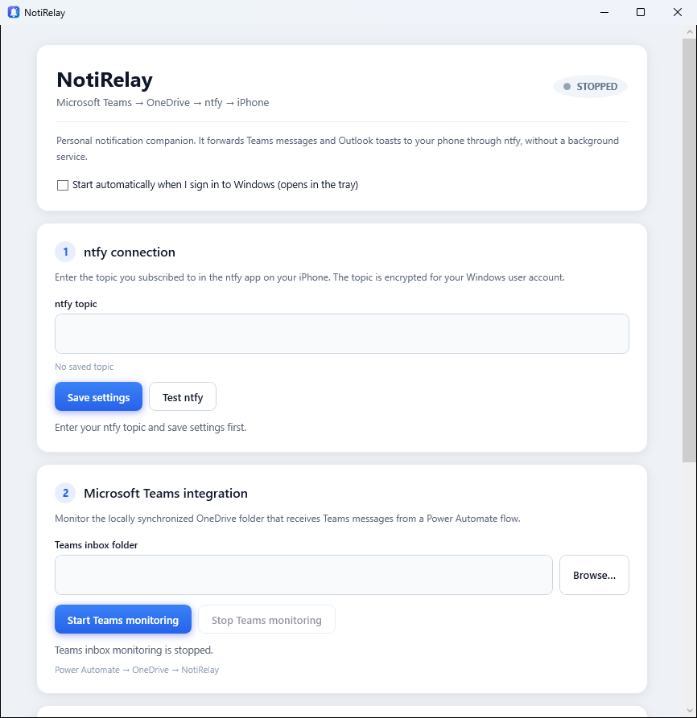
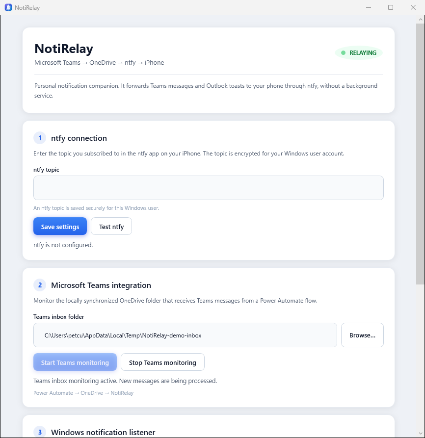
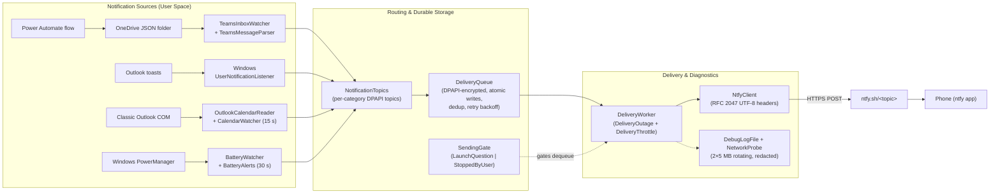

# NotiRelay

[](https://github.com/iulian880/noti-relay/actions/workflows/build.yml)


[](https://github.com/iulian880/noti-relay/releases)


A **zero-dependency Windows desktop tray app** (WPF, .NET 10) that forwards **Microsoft Teams messages**, **Outlook desktop notifications**, **Outlook calendar updates & reminders**, and **laptop low-battery alerts** to your phone over HTTPS via [ntfy](https://ntfy.sh) — with no background service, no administrator rights, and no runtime to install.

Built with **DPAPI-encrypted local storage**, a **durable persistent delivery queue**, **per-category ntfy topic routing**, **rate-limit pacing**, **privacy-first redacting diagnostics**, and **136 automated tests** across 15 test suites.

> **Portfolio note:** published to demonstrate practical Windows desktop engineering — sparse-identity WinRT integration, leak-free late-bound Outlook COM, DPAPI secret handling, resilient delivery mechanics, and cross-platform unit testing of a WPF codebase. It only forwards notifications to a destination you configure, after explicit confirmation. Use any notification source and destination only where you are allowed to; it does not bypass IT, network, or application-control policies, and you should not use it to route another organization's data without permission.

---

## The problem — and why it is built this way

Stepping away from a locked-down Windows workstation often means missing urgent Teams messages, last-minute meeting reschedules, or a draining laptop battery — especially when corporate policies restrict mobile MDM enrollment, admin installs, or Microsoft Graph app consents.

`NotiRelay` is engineered to run entirely in user space as a portable tray utility while staying reliable, auditable, and respectful of corporate constraints:

| Dimension | Generic toast forwarders | Microsoft Graph / webhook bots | Cloud sync bridges | `NotiRelay` |
|---|---|---|---|---|
| **Install & privileges** | Often require admin install or background services | Require Azure AD app registration & admin consent | Require third-party cloud accounts | **Single portable `.exe`** or per-user sparse MSIX — **no admin rights, no Windows service, no runtime** |
| **Teams message bodies** | Truncated or missing in Windows toasts | Full text, but needs Graph permissions | Varies | **Full message text + attachment names** via a local Power Automate → OneDrive JSON folder (zero public webhooks) |
| **Outlook calendar** | Only fires if Outlook triggers a toast | Needs Graph calendar scopes | Copies calendar into an external cloud | **Direct read-only late-bound COM** against running classic Outlook: changes in ~15 s, `08:45` daily agenda, 10-min reminders — **never reads bodies/attendees, copies nothing out** |
| **Secrets & queued data** | Plaintext config files | Server-side token storage | Cloud-stored credentials | **Windows DPAPI (`CurrentUser`)** for every ntfy topic and the entire persistent queue, with `ZeroMemory` buffer wiping |
| **Network blips & rate limits** | Drop notifications or spam retries | Depends on webhook retries | Opaque | **Durable queue + `DeliveryOutage` pause + HTTP 429 `DeliveryThrottle`** (paces 1 msg / 5 s in strict order) |
| **Backlog safety** | Floods phone with stale messages on restart | N/A | N/A | **Launch prompt** asks before sending anything missed while closed, plus a one-click **`Stop sending`** kill-switch |
| **Runtime footprint** | Heavy frameworks / Electron | Cloud hosting | Cloud hosting | **Zero runtime NuGet packages** — pure .NET 10 WPF + WinRT/COM |

---

## Notification sources & highlights

### Four independent notification sources

| Source | Mechanism | What reaches your phone |
|---|---|---|
| **Microsoft Teams messages** | Watches a local OneDrive-synced folder of JSON files exported by a Power Automate flow (`TeamsInboxWatcher` + `TeamsMessageParser`) | Full plain-text body (HTML stripped cleanly while keeping custom emoji alt text, `[Image]` placeholders, and `📎` file attachment names); empty system/deleted events are marked handled so they never loop |
| **Outlook desktop toasts** | Official Windows `UserNotificationListener` WinRT API (explicit one-time user confirmation required) | Outlook desktop toast notifications detected by Windows |
| **Classic Outlook calendar** | Polls the running classic Outlook instance every 15 s via late-bound COM (`OutlookCalendarReader` + `CalendarWatcher`) | **New, moved, or cancelled meetings** over the next 7 days, **today's agenda at `08:45`** (switches to *"Rest of today"* if sent late), and a **10-minute reminder** before each active busy meeting |
| **Laptop power & battery** | Polls Windows `PowerManager` every 30 s (`BatteryWatcher` + `BatteryAlerts`) | Low-battery warnings at **30%** (`high`) and **10%** (`urgent`) while discharging, with a +5% hysteresis margin so flickering readings never repeat alerts |

### Reliability, safety & privacy highlights

- **Per-category ntfy topic routing.** Route **Teams messages**, **Outlook notifications**, **Meetings**, and **Power & battery** to separate ntfy topics (or fall back to the main topic), each stored DPAPI-encrypted. **Send test** groups categories by distinct target topic and sends one clearly labelled test per active topic.
- **Nothing old is sent without asking.** On startup, `SendingGate` holds delivery until any backlog (unsent items still in the queue plus Teams/Outlook messages that arrived while the app was closed) is reviewed. A modal dialog shows exact counts and the oldest timestamp: **Yes, send them** relays oldest-first (marking missed items `Missed ·`); **No, start from now** discards them permanently and forwards only new activity.
- **Instant `Stop sending` kill-switch.** Available in both the header bar and the system tray menu (protected by `ActionDebounce` against accidental double-clicks). Halts all outbound HTTP deliveries immediately — including items already queued — while **Resume sending** prompts whether to deliver or discard everything collected in the meantime.
- **Durable DPAPI-encrypted queue with outage & HTTP 429 pacing.** Queued notifications persist in `%LOCALAPPDATA%\NotiRelay\delivery-queue.dat` encrypted for the current Windows user, written atomically via `.tmp` swap, capped at 500 items, and deduplicated by ID. Network outages pause the whole queue with exponential backoff (`5 s` → `5 min`) and log one summary line instead of per-item spam; HTTP 429 responses keep the item first in line and pace delivery at 1 notification every `5 s`.
- **Privacy-first logs & built-in network diagnostics.** Notification text, message bodies, and meeting titles are never written to the on-screen Activity log or the debug log. Toggling **Debugging** writes millisecond-timestamped diagnostics to `NotiRelay-debug.log` (next to the `.exe`, falling back to `%LOCALAPPDATA%\NotiRelay`, rotating at 2 × 5 MB), masks all configured topics and embedded proxy URL credentials, and runs a read-only 4-step `NetworkProbe` (Windows proxy → DNS → TCP 443 → `https://ntfy.sh/v1/health`).
- **Baseline on first run & unobtrusive tray UX.** Existing inbox files, toasts, and calendar entries are recorded as a baseline on first start so nothing historical fires. Supports minimize-to-tray, a live header status pill, and optional per-user **Start with Windows** (`HKCU\Software\Microsoft\Windows\CurrentVersion\Run`, launching straight into the tray).

---

## Screenshots

Real captures of the Windows desktop UI (stopped and actively relaying — the header pill switches to green, pulses, and reflects active state):





> *Note: Screenshots show the desktop UI foundation; v1.4.0 additionally includes the header `Stop sending` button, per-category ntfy topic rows, and cards for **Outlook calendar**, **Power & battery**, and **Debugging** in the Activity log.*

---

## Architecture



### Stack & repository layout

| Area | Choice |
|---|---|
| **Runtime & UI** | .NET 10 (`net10.0-windows10.0.19041.0`), WPF + WinForms system tray icon |
| **Runtime NuGet packages** | **0** — pure BCL, WinRT, and late-bound COM (no MVVM toolkit, no third-party UI libraries) |
| **Outlook toasts** | `Windows.UI.Notifications.Management.UserNotificationListener` via sparse-identity MSIX |
| **Teams messages** | OneDrive-synced JSON folder written by Power Automate; custom HTML-to-plain-text parser |
| **Outlook calendar** | Late-bound COM (`CLSIDFromProgID` + `GetActiveObject`) with deterministic `Marshal.ReleaseComObject` |
| **Battery telemetry** | `Windows.System.Power.PowerManager` |
| **Secrets & queue at rest** | Windows DPAPI (`ProtectedData`, `DataProtectionScope.CurrentUser`) + `CryptographicOperations.ZeroMemory` |
| **Autostart** | Per-user `HKCU\Software\Microsoft\Windows\CurrentVersion\Run` |
| **Tests** | xUnit (`2.9.2`) on plain `net10.0` linking 15 platform-neutral source files — **136 tests** runnable on macOS, Linux, and Windows |
| **Packaging & CI** | GitHub Actions (`windows-latest`): runs tests and publishes a compressed self-contained `win-x64` single-file `.exe`; optional per-user sparse-identity MSIX (`build-package.ps1` / `install-current-user.ps1`) |

---

## Technical challenges

- **WinRT `UserNotificationListener` without admin rights or full MSIX lock-in.** Windows gates `UserNotificationListener` behind package identity. Instead of converting to a restricted full MSIX or installing a Windows service, `NotiRelay` uses Microsoft's supported **sparse identity package** (`Package.appxmanifest` + `Add-AppxPackage -ExternalLocation`), registered per-user with no elevation, while the portable app binary stays directly runnable.
- **Leak-free, prompt-free Outlook calendar reading over late-bound COM.** Reading classic Outlook without shipping Office PIA/COM references uses P/Invoke (`CLSIDFromProgID` + `GetActiveObject`) so it attaches only to an already-running Outlook and never launches it. Every COM reference is tracked and released in reverse order (`Marshal.ReleaseComObject`) so Outlook closes cleanly. Meeting bodies and attendees are never touched (avoiding Outlook's Object Model Guard prompts). Recurring meeting exceptions resolve back to their `OriginalDate` so a rescheduled occurrence keeps a stable `OccurrenceKey` and reports as **moved** rather than a duplicate; date windows are re-checked in C# because Outlook Jet `Restrict` filters depend on Windows regional formats; and transient empty reads during Outlook startup/shutdown preserve the previous snapshot instead of firing false "new meeting" bursts.
- **Order-preserving delivery across outages and HTTP 429 rate limits.** Treating a `429 Too Many Requests` like a normal failure would increment attempt counts, push items back out of order, and spam logs. `DeliveryWorker` separates **outages** (`DeliveryOutage`: pauses the whole queue with `5 s` → `5 min` backoff and logs only state changes) from **rate limiting** (`DeliveryThrottle`: leaves the item at the head of the queue and paces deliveries to 1 every `5 s`, doubling only if ntfy continues refusing), all gated behind a lock-free bitmask `SendingGate` (`LaunchQuestion | StoppedByUser`).
- **Non-ASCII HTTP headers and Teams attachment edge cases.** .NET's `HttpClient` rejects non-ASCII characters (e.g., diacritics in sender names or meeting subjects) in HTTP headers; `NtfyClient` automatically encodes non-ASCII `Title` headers using **RFC 2047 UTF-8 Base64 encoded-words** (`=?UTF-8?B?...?=`). On the Teams side, `TeamsMessageParser` separates permanently empty system/deleted events (`nothingToForward`) from incomplete mid-sync JSON files, preventing endless retry loops while extracting attachment file names from `message.attachments`.
- **Cross-platform unit testing for a WPF/WinRT codebase.** Rather than requiring a Windows desktop session to verify core rules, 15 pure logic modules (`CalendarNotifications`, `CalendarState`, `DeliveryThrottle`, `DeliveryOutage`, `SendingGate`, `MissedMessages`, `TeamsMessageParser`, `NtfyClient`, `NtfyTopic`, `NtfyErrors`, `NotificationTopics`, `BatteryAlerts`, `DebugLogFile`, `DebugReport`, `NetworkProbe`) are kept free of WPF/WinRT/DPAPI types and linked directly into `tests/NotiRelay.Tests` targeting plain `net10.0`. All **136 tests** run in under 100 ms on macOS, Linux, and Windows.
- **Redacting live diagnostics without locking the log file.** `DebugLogFile` strips embedded credentials from proxy URLs and masks every configured ntfy topic longest-first (fully redacting short topics to `••••` so the last 4 characters don't leak them), opens the file with `FileShare.ReadWrite | FileShare.Delete` so users can open or copy it while active, and rotates at 2 × 5 MB.

---

## Download

Grab the latest `NotiRelay-<version>.exe` from the [Releases](https://github.com/iulian880/noti-relay/releases) page.

It is a compressed, self-contained `win-x64` single-file executable: copy it to any Windows 10/11 PC and run it — no .NET install and no administrator rights required. Every push to `main` runs tests and rebuilds the executable on Windows via GitHub Actions, updating the release automatically; pull requests upload test builds under workflow **Artifacts**.

---

## Build, test & run

Requires the **.NET 10 SDK** (Windows 10/11 x64 to run the app; macOS/Linux can also compile and run the full unit test suite because `EnableWindowsTargeting` is enabled).

```powershell
# Run all 136 unit tests across 15 suites
dotnet test tests/NotiRelay.Tests -c Release

# Build the app
dotnet build src -c Release

# Run locally (Windows)
dotnet run --project src
```

### Single-file self-contained executable

```powershell
dotnet publish src -c Release -r win-x64 --self-contained true `
  -p:PublishSingleFile=true -p:IncludeNativeLibrariesForSelfExtract=true `
  -p:EnableCompressionInSingleFile=true -o out\single
```

### Sparse-identity MSIX (for the Windows notification listener)

Per-user, no admin rights required:

1. Run `build-package.ps1` on your build machine (generates the sparse identity package under `out\deploy`; the private signing key never leaves the build machine).
2. Copy `out\deploy` to the target PC and run `install-current-user.ps1`.
3. Remove cleanly at any time with `uninstall-current-user.ps1`.

---

## ntfy setup & troubleshooting

### Quick setup

1. Pick a **long, random, unguessable topic** (anyone who knows an `ntfy.sh` topic can read notifications posted to it) and subscribe to it in the ntfy app on your phone (or at `https://ntfy.sh/<topic>`).
2. Paste the bare topic or full `https://ntfy.sh/<topic>` URL into **ntfy topic** and press **Save topic** (or Enter). Input is normalized and validated before saving, stored DPAPI-encrypted in `%LOCALAPPDATA%\NotiRelay`, and confirmed using only its last four characters (`✓ Saved: ••••9q2x`). Optionally set separate topics per category (**Teams messages**, **Outlook notifications**, **Meetings**, **Power & battery**).
3. Press **Send test** to verify every active topic.
4. Enable the sources you want: select your synced OneDrive folder for Teams, tick the explicit confirmation once for Outlook toasts, start **Outlook calendar**, or toggle **Power & battery**.

### Troubleshooting

If notifications stop reaching your phone:

1. Click **Debugging** in the **Activity log** card (it stays active across restarts until toggled off).
2. Check the one-line **Network check** summary printed in the Activity log (runs proxy → DNS → TCP 443 → `https://ntfy.sh/v1/health`).
3. Wait a minute (or restart the app to capture startup), then click **Show file** to inspect or share `NotiRelay-debug.log` (all topics, proxy credentials, message bodies, and meeting titles are excluded/masked).
4. Click **Debugging ON** again to disable file logging.

---

## Notes

- Some code comments reference an internal design document not tracked in this repository; feature design specs and implementation plans live under [`docs/superpowers/`](docs/superpowers/).
- One user-facing synthetic test message (`NtfyClient.SendSyntheticTestAsync`) is intentionally in Romanian; the rest of the UI and logs are in English.

---

Portfolio project, not open source. © 2026 Petcu Iulian. All rights reserved. See [LICENSE](LICENSE).
